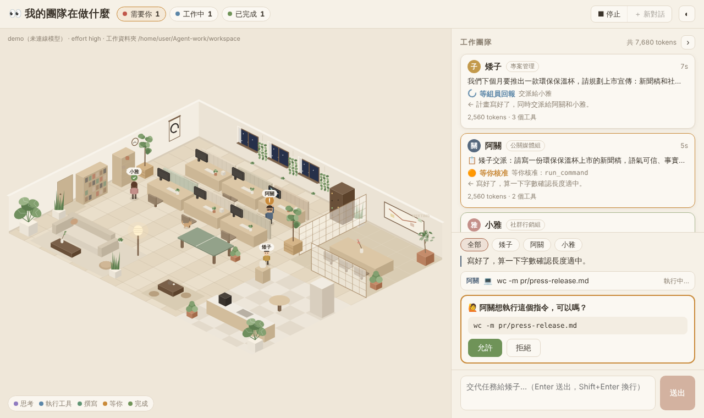

# Agent-work

一個**會自己分工的 AI 工作團隊**：你把目標交給專案管理人員，他會規劃、把工作交派給組員，大家各自讀寫檔案、執行指令、上網搜尋，最後由他彙整回報。網頁上有一間奶油侘寂風的等角小辦公室，**即時顯示每位成員正在做什麼**。



<sub>用 `--demo` 錄的畫面，沒有連到真的模型。</sub>

視覺設計參考了 [Charonyuu/whatsmyagentdoing](https://github.com/Charonyuu/whatsmyagentdoing)。那個專案是「監看別的 Agent 在做什麼」的儀表板，這裡把同樣的概念用在我們自己寫的 Agent 上。程式碼是重新撰寫的，沒有複製原專案的程式。

## 工作團隊

每位成員都是一個獨立的 Claude Agent，有自己的角色設定和對話記憶，共用同一個工作資料夾。

| 成員 | 角色 | 負責 |
|---|---|---|
| **矮子** | 專案管理 | 你直接交代他。拆解任務、寫交派說明、讓組員同時開工，回報後檢查內容是否一致，最後彙整給你 |
| **阿關** | 公關媒體組 | 新聞稿、媒體邀請函、採訪問答、聲明稿 |
| **小雅** | 社群行銷組 | IG／Facebook／Threads 貼文、hashtag、內容行事曆、互動活動 |

矮子用 `delegate` 工具交派任務；同一輪交派給兩個人時，阿關和小雅會同時工作。組員只看得到交派說明和工作資料夾裡的檔案，所以矮子會把目標、受眾、語氣、已知事實和存檔位置寫清楚。組員不會編造日期、價格或聯絡方式，需要你確認的地方會標成【待確認】。

角色設定寫在 `src/team.js`，想調整分工或語氣可以直接改那裡的提示詞。注意：一個任務會呼叫好幾個 Agent，API 用量會比單一 Agent 多。

## 快速開始

需要 Node.js 18 以上。

```bash
npm install

# 先不用 API key，看一段示範（矮子交派新聞稿和貼文，阿關請你核准指令）
npm start -- --demo

# 正式使用
export ANTHROPIC_API_KEY=sk-ant-...
npm start
```

瀏覽器會打開 http://127.0.0.1:4546 。輸入任務交給矮子，例如：

- 我們下個月要推出一款環保保溫杯，請規劃上市宣傳：新聞稿和社群貼文
- 週末要在市集辦快閃店，請準備媒體邀請函和三則 IG 貼文
- 看看工作資料夾裡有什麼，幫我整理一份進度報告

也可以不開網頁，直接在終端機跑一個任務：

```bash
node bin/cli.js -t "幫新咖啡豆寫一則新聞稿和兩則 IG 貼文"
```

## 成員能用的工具

| 工具 | 作用 | 需要核准 |
|---|---|---|
| `list_files` | 列出工作資料夾裡的檔案 | 否 |
| `read_file` | 讀取文字檔 | 否 |
| `write_file` | 建立或覆寫檔案 | 否 |
| `run_command` | 在工作資料夾執行 shell 指令（120 秒逾時） | **是** |
| `web_search` | 上網搜尋（Anthropic 伺服器端工具） | 否 |
| `delegate` | 把任務交派給阿關或小雅，等他們回報（只有矮子有） | 否 |

所有檔案操作都限制在工作資料夾（預設 `./workspace`）裡；`../`、絕對路徑或指向外面的符號連結都會被拒絕。執行指令前網頁會跳出「允許／拒絕」卡片，終端機模式則會問 `[y/N]`。

## 網頁上看得到什麼

**辦公室（2D 等角視角，canvas 繪製，零依賴）**：奶油侘寂風，淺色木地板、亞麻地毯、米白灰泥牆、木格紙門隔出的會議室、牆上的圓相（ensō）掛軸和紙燈籠，還有很多綠色植物：龜背芋、琴葉榕、橄欖樹、虎尾蘭、牆上垂下的黃金葛，每張桌上和窗台也有小盆栽。

三位成員各有座位和外型（矮子個子比較矮、阿關戴眼鏡、小雅長髮）。工作時坐在座位上，思考時頭上有思考泡泡，執行工具時一邊打字、螢幕跑程式碼，頭上顯示在做什麼；需要你核准時會站起來揮手、頭上冒出「!」。矮子交派任務後會走到會議室的白板前，等組員回報。沒事的成員會四處走動：去茶水間倒咖啡、喝水、開冰箱，在茶席喝茶，到沙發滑手機、看書架、打桌球、看窗外、幫植物澆水。窗外天色隨你的當地時間變化，還有一隻辦公室的貓。把滑鼠移到成員身上可以看到他在做什麼，點他會跳到右側他的卡片。

**右側面板**：每位成員一張卡片，顯示目前任務、狀態、最後一句回覆、token 用量和計時。下方是全團隊的時間軸（交派、思考、工具呼叫和結果，可以點開看完整內容），每一項都標了是誰做的，可以用「全部／矮子／阿關／小雅」篩選。面板可以用 › 收起，讓辦公室占滿畫面。上方工具列的「需要你／工作中／已完成」會統計整個團隊。支援深色模式（右上角 ◐ 切換）和手機。

| 狀態 | 意思 |
|---|---|
| 💭 思考中 | 模型正在推理（會顯示思考摘要） |
| ⏳ 執行工具 | 正在跑某個工具，例如 `wc -m pr/press-release.md` |
| 📋 等組員回報 | 矮子交派了任務，正在等阿關或小雅 |
| ✍️ 撰寫回覆 | 正在寫給你的回答 |
| 🟠 等你核准 | 想執行指令，等你按允許或拒絕 |
| ✅ 完成 | 這一輪結束 |
| ■ 已中斷 / ❗ 發生錯誤 | |

重新整理頁面會重播整段對話。

## 選項

```
-p, --port <n>        網頁埠號（預設 4546，被占用時自動往後找）
    --host <addr>     綁定位址（預設 127.0.0.1，只有本機能連）
-w, --workspace <dir> Agent 可以讀寫、執行指令的資料夾（預設 ./workspace）
    --model <id>      模型（預設 claude-opus-5-5）
    --effort <level>  low | medium | high | xhigh | max（預設 high）
    --auto-approve    執行指令前不詢問（小心使用）
    --no-web          關閉網路搜尋工具
    --no-open         不自動開瀏覽器
    --demo            示範模式：不呼叫 API，播放一段團隊分工的過程
-t, --task <text>     在終端機直接執行一個任務
```

## 運作原理

每位成員都跑一個標準的 **ReAct 迴圈**（推理 → 行動 → 觀察 → 再推理）。矮子的 `delegate` 工具會啟動組員的迴圈，等它跑完後把組員的回報當成工具結果交回給矮子：

```
使用者任務
   │
   ▼
呼叫 Claude（附上工具清單與目前對話）──► 把思考／文字即時串流到網頁
   │
   ├─ 回覆裡有 tool_use？
   │     是 → 驗證參數 →（需要時請你核准）→ 執行工具
   │          → 把 tool_result 加回對話 → 回到上面再呼叫一次
   │     否 → 任務完成，顯示最後的回答
```

- `src/team.js`：團隊成員的角色設定、`delegate` 工具，以及把三個 Agent 的事件合成同一個串流。
- `src/agent.js`：單一成員的 Agent 迴圈。用 `@anthropic-ai/sdk` 串流呼叫 Claude Opus 5.5，開啟 adaptive thinking 並顯示思考摘要；思考區塊原樣傳回，讓推理保持連貫；使用提示快取降低重複輸入的成本；處理 `pause_turn`、`max_tokens`、`refusal` 等停止原因。每則訊息最多 40 步，避免無限迴圈。
- `src/tools.js`：工具定義、參數驗證，以及把路徑限制在工作資料夾內的檢查。
- `src/server.js`：零依賴的 HTTP 伺服器，用 Server-Sent Events 把團隊的每個事件推到網頁。
- `public/office.js`：辦公室場景的 canvas 繪圖、成員的外型與走動。
- `public/`（其他檔案）：工具列、側邊面板、時間軸和核准卡片。
- `src/demo.js`：假的模型客戶端，給 `--demo` 和測試使用。

另外啟用了 Anthropic 的伺服器端備援（`fallbacks: "default"`）：如果安全分類器拒絕某個請求，API 會自動改用合適的備援模型重試，網頁上會出現一行提示。不需要的話，可以在 `src/agent.js` 的 `callModel()` 裡刪掉 `betas` 和 `fallbacks` 兩行。

## 測試

```bash
npm test
```

測試使用假的模型客戶端，不需要 API key，涵蓋：工具呼叫迴圈、指令核准與拒絕、參數驗證、拒絕工作資料夾外的路徑（含符號連結）、中斷後繼續對話、矮子同時交派給兩位組員並收到回報、不會打斷正在忙的組員。

## 安全提醒

每位成員都可以在工作資料夾裡執行任意指令。請保持預設的「執行前詢問」，只有在你信任任務內容時才用 `--auto-approve`；也不要把伺服器綁到 `0.0.0.0` 讓其他人連進來。
